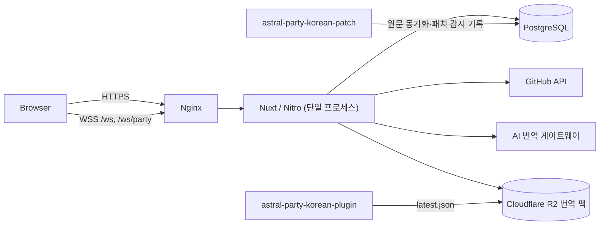

# 아키텍처

## 시스템 구성

이 저장소는 웹 앱과 DB schema를 소유합니다. 원문 데이터와 패치 감시 기록은 `astral-party-korean-patch`가 같은 DB에 씁니다.

## 계층

| 경로 | 책임 |
| --- | --- |
| `app/pages` | 라우팅, 화면 조합, 페이지 상태 |
| `app/components` | 재사용 UI (`editor/`, `mod/`, `party/`, `home/`, `change/`, `admin/` …) |
| `app/composables` | 브라우저 상태와 기능 로직 (`editor-*`, `party-chat`, `change-log-*` …) |
| `app/utils` | 부작용 없는 포맷·검증·diff 헬퍼 |
| `server/api` | 입력 파싱과 HTTP 응답. 가능한 한 얇게 유지 |
| `server/routes` | OAuth(`/auth/*`), WebSocket(`/ws`, `/ws/party`), `/.well-known/assetlinks.json` |
| `server/middleware` | 세션 갱신(`session-refresh.ts`), 모드 API 캐시 헤더(`mod-cache.ts`) |
| `server/plugins` | 파티 채팅 종료 신호 처리, 만료 세션·30일 지난 연결 로그 정리 (1분 주기) |
| `server/utils` | 인증, 권한, 트랜잭션, 쿼리, 외부 API |
| `shared/types` | 클라이언트·서버 공용 타입과 상수 |

`server/utils`의 큰 영역은 하위 폴더로 나눕니다.

| 위치 | 내용 |
| --- | --- |
| `editor/` | 번역 목록 필터·쿼리 |
| `editor-dictionary/` | 용어집 항목 |
| `github/` | GitHub API 클라이언트·정규화 (릴리즈 피드) |
| `patch-watcher/` | 패치 감시 상태·이력 |
| `party-chat*.ts` | 파티 채팅 상태·입장·참가자·메시지·저장·제한 |
| `validation.ts`, `request-security.ts`, `batch.ts` | 공용 입력 검증, 변경 요청 검사, 일괄 처리 |

## 인증과 역할

Google OAuth(`nuxt-auth-utils`)로 로그인합니다. 첫 로그인 시 `app_users`에 `user` 역할로 저장하고, handle이 없으면 `/setup`으로 보냅니다.

| 역할 | 권한 |
| --- | --- |
| `user` | 번역 제안, AI 번역, 용어집, 댓글, 모드 등록 |
| `verified` | `user` + 번역 승인·반려 |
| `admin` | 전체 관리 (역할 변경, 공지, 패치 감시 설정, 번역 팩 배포, 모든 모드 관리) |
| `bot` | 자동화 전용 예약 계정 |

- 세션은 봉인된 쿠키(`nuxt-session`)이며 30일 sliding 만료입니다. HTML GET 요청에서 `refreshedAt` 기준 24시간에 한 번만 쿠키를 다시 발급합니다(`server/middleware/session-refresh.ts`).
- 권한이 필요한 작업은 세션 값을 그대로 믿지 않고 `server/utils/auth-user.ts`의 헬퍼로 DB 계정을 다시 확인합니다. DB와 세션이 다르면 세션을 동기화합니다.

## 실시간 갱신

| 엔드포인트 | 용도 |
| --- | --- |
| `/ws` | 공용 허브. 클라이언트가 `editor`, `editor:comment`, `change:translation` 토픽을 구독하면 서버가 번역 저장·검토·댓글 이벤트를 발행합니다 (`server/utils/ws-hub.ts`, `app/composables/astral-websocket.ts`). |
| `/ws/party` | 파티 채팅 전용. [party-chat.md](party-chat.md) 참고 |

두 엔드포인트 모두 Origin을 검사합니다(`server/utils/ws-origin.ts`). 연결 상태를 프로세스 메모리에 두므로 앱은 단일 프로세스로 운영합니다.

## 캐시

실시간 성격의 화면(에디터, 변경 기록, 검토)은 캐시하지 않습니다. 외부 API와 자주 바뀌지 않는 응답만 Nitro 캐시를 사용합니다.

| 대상 | 유지 시간 |
| --- | --- |
| `/api/astral-server` (게임 서버 상태·공지) | 30초, stale-while-revalidate |
| `/api/status`, `/api/status/history` | 30초 |
| `/api/releases`, `/api/releases/history` | 60초 |
| `/api/party/characters` | 5분 |
| 모드 GitHub 정보 | 저장소별 5분 (응답 자체는 `no-store`) |

## 요청 보안

상태를 바꾸는 요청은 다음을 거칩니다.

- same-origin 검사 (`assertMutationRequest`)
- JSON content type과 body 최대 128 KiB (`readJsonBody`)
- 사용자별 분·시간 단위 요청 제한 (`editor-rate-limit.ts`, `mod-rate-limit.ts`, DB `request_rate_limit_counters`)
- 세션 사용자의 DB 재확인
- `postgres` 태그드 템플릿 파라미터 바인딩 (문자열 SQL 결합 금지)

웹 요청에서는 DDL을 실행하지 않습니다. PostgreSQL은 loopback에만 바인딩합니다.

## 주요 API

| 그룹 | 엔드포인트 |
| --- | --- |
| 번역 목록·진행도 | `GET /api/editor/items`, `GET /api/editor/overview` |
| 번역 저장 | `PATCH /api/editor/items/batch`, `POST /api/editor/items/:id/retain`, `POST /api/editor/items/:id/ai-translation` |
| 검토 | `GET /api/editor/review`, `POST /api/editor/review/candidates`, `PATCH /api/editor/changes/:id`, `PATCH /api/editor/changes/batch` |
| 이력 | `GET /api/editor/items/:id/history`, `GET /api/editor/log/*` |
| 댓글 | `GET`/`POST /api/editor/comments` |
| 용어집 | `GET`/`POST /api/editor/dictionaries`, `GET`/`POST /api/editor/dictionaries/:id/entries` |
| 모드 | `/api/mods`, `/api/mods/:id` ([mod-hub.md](mod-hub.md)) |
| 파티 | `POST /api/party/rooms`, `GET /api/party/characters` |
| 공개 정보 | `/api/releases`, `/api/status`, `/api/notices`, `/api/contributors`, `/api/astral-server`, `GET /api/users/:handle` |
| 계정 | `GET`/`PATCH`/`DELETE /api/profile` |
| 관리자 | `/api/admin/users`, `/api/admin/patch-watcher`, `/api/admin/translation-pack`, `POST /api/notices` |
| 인증 | `/auth/login`, `/auth/google`, `/auth/continue` |
