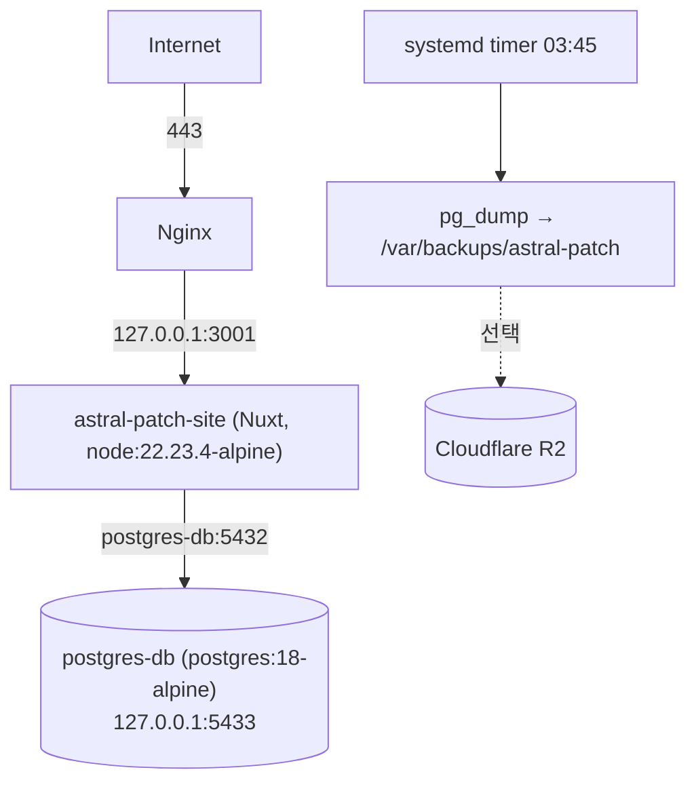
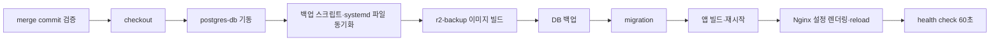

# 배포와 운영

Ubuntu VM 한 대에서 Docker Compose + Nginx로 운영합니다. Nuxt와 PostgreSQL은 loopback에만 바인딩하고 외부에는 Nginx 80/443만 엽니다.

## 구성



| Compose 서비스 | profile | 역할 |
| --- | --- | --- |
| `astral-patch-site` | 기본 | 웹 앱 (`Dockerfile`) |
| `postgres-db` | 기본 | PostgreSQL 18, 볼륨 `pgdata` |
| `db-migrate` | `migration` | `deploy/run-migrations.sh` 실행 ([database.md](database.md)) |
| `r2-backup` | `backup` | 백업 파일 R2 업로드 (`Dockerfile.r2-backup`) |

Compose 프로젝트 이름은 항상 `-p astral-patch`, 권장 작업 디렉터리는 `/home/ubuntu/astral-patch-site`입니다.

## 서버 환경변수

```bash
cd /home/ubuntu/astral-patch-site
install -m 600 /dev/null .env
```

`.env.example`의 **3. 서버 운영 환경** 구역을 기준으로 채웁니다. 최소 구성:

```dotenv
NUXT_SESSION_PASSWORD=<32자 이상 임의 값>
NUXT_OAUTH_GOOGLE_CLIENT_ID=
NUXT_OAUTH_GOOGLE_CLIENT_SECRET=
NUXT_ANDROID_CERTIFICATE_SHA256=<AA:BB:... 형식>

POSTGRES_DB=astral_patch
POSTGRES_USER=astral_patch
POSTGRES_PASSWORD=<강력한 비밀번호>
DATABASE_URL=postgresql://astral_patch:<URL 인코딩한 비밀번호>@postgres-db:5432/astral_patch

ASTRAL_APP_PORT=3001
ASTRAL_DB_HOST_PORT=5433
```

선택: `AI_API_KEY`, `AI_BASE_URL`, `GITHUB_TOKEN`, `ASTRAL_WS_*`, R2 변수(아래). systemd 백업 설정은 `.env`가 아니라 `/etc/default/astral-patch`에 둡니다.

## 최초 설치

```bash
# 1. DB
docker compose -p astral-patch up -d postgres-db

# 2. schema
docker compose -p astral-patch --profile migration run --rm db-migrate

# 3. 앱
docker compose -p astral-patch up -d --build --remove-orphans astral-patch-site
curl -I http://127.0.0.1:3001/

# 4. Nginx, HTTPS(certbot), 백업 timer
sudo env \
  ASTRAL_DOMAIN=astral.example.com \
  ASTRAL_CERTBOT_EMAIL=admin@example.com \
  ASTRAL_APP_PORT=3001 \
  ASTRAL_APP_DIR=/home/ubuntu/astral-patch-site \
  bash deploy/bootstrap-server.sh
```

Google OAuth 클라이언트에 redirect URI `https://<도메인>/auth/google`을 등록합니다.

## 자동 배포

공통 용어집의 데이터 등록과 검수·복구 절차는 [공통 용어집 운영 반영](glossary-release.md)에 정리되어 있습니다. 기초 용어는 기존 migration 단계에서 자동 등록하며 별도 환경변수나 운영 데이터 가져오기를 요구하지 않습니다.

`develop → release` PR이 merge되면 `.github/workflows/deploy.yml`(`Deploy`)가 SSH로 서버에 접속해 다음을 실행합니다.



- 배포 대상은 merge commit이며, `origin/release`보다 오래된 commit이면 건너뛰고 `release`에 없는 commit이면 실패합니다.
- 서버에 이미 더 새로운 commit이 있으면 건너뜁니다.
- Nginx 설정은 매번 `deploy/render-nginx-config.sh`로 `deploy/nginx/astral-patch-site.conf.template`에서 다시 만들고 `nginx -t` 후 reload합니다(`/ws`, `/ws/party` Upgrade 포함).
- health check는 `http://127.0.0.1:${ASTRAL_APP_PORT}/`를 2초 간격 30회 확인하고, 실패하면 서버의 배포 로그 파일에 앱 로그 150줄을 추가한 뒤 실패합니다.
- `release`·`master`에 직접 push해도 배포되지 않습니다. 수동 재배포는 Actions에서 `Deploy`를 실행하며 항상 `origin/release` 최신 commit을 사용합니다.
- migration은 새 앱 시작 전에 적용되므로, 이전 앱을 깨뜨리는 schema 변경은 두 번에 나눠 배포합니다([database.md](database.md#migration-규칙)).

### 배포 실패 로그

- Git·빌드·migration·Nginx·health check 등 배포 명령의 표준 출력과 오류는 서버의 `/var/log/astral-patch/deploy/`에만 기록합니다. Actions에는 완료·건너뜀 여부 또는 실패 코드와 서버 로그 경로만 출력하며, 파일 내용은 업로드하지 않습니다.
- 배포 전 DB 백업 서비스 자체의 출력은 서버의 systemd journal에 남습니다. 배포 로그 파일에는 `systemctl` 호출 결과가 기록됩니다.
- 성공하거나 오래된 배포를 건너뛰면 파일을 삭제하고, 실패한 경우에만 남깁니다. 파일 삭제가 실패하면 Actions도 실패로 표시하고 남은 서버 로그 경로를 알립니다. 파일명은 `deploy-<UTC 시각>-<Actions run ID>-<attempt>-<임의 값>.log`입니다.
- 상위 `/var/log/astral-patch/`는 `root:root` 소유의 `0755`, `deploy/`는 배포 계정 소유의 `0700`, 파일은 `0600` 권한으로 생성합니다. 배포 계정에 해당 디렉터리를 생성하는 `sudo -n install` 권한이 필요합니다. 디렉터리나 파일을 준비하지 못하면 배포를 시작하지 않습니다.
- 14일을 초과한 배포 로그는 다음 배포 시 삭제합니다. 실패 로그에는 민감한 진단 정보가 포함될 수 있으므로 공개 경로나 Actions 아티팩트로 복사하지 않습니다.
- SSH 연결 자체가 실패하면 서버 로그를 만들 수 없습니다. 이 경우 연결 실패는 Actions에서 확인합니다.

서버에 SSH로 접속한 뒤 확인합니다.

```bash
sudo ls -lt /var/log/astral-patch/deploy/
sudo less /var/log/astral-patch/deploy/deploy-<확인할 파일>.log
sudo journalctl -u astral-patch-db-backup.service -n 150 --no-pager
```

### GitHub Secrets

| 이름 | 필수 | 예 |
| --- | --- | --- |
| `SERVER_HOST` | ✓ | VM IP 또는 호스트 |
| `SERVER_USER` | ✓ | `ubuntu` |
| `SERVER_SSH_KEY` | ✓ | 배포용 개인키 |
| `SERVER_SSH_FINGERPRINT` | ✓ | `sudo ssh-keygen -lf /etc/ssh/ssh_host_ed25519_key.pub -E sha256 \| awk '{print $2}'` |
| `SERVER_WORK_DIR` | ✓ | `/home/ubuntu/astral-patch-site` |
| `SERVER_SSH_PORT` | | `22` |

배포 사용자는 위 단계의 `sudo -n` 명령(파일 설치, `systemctl`, `nginx`)을 비밀번호 없이 실행할 수 있어야 합니다.

## 백업

`astral-patch-db-backup.timer`가 매일 03:45에 `astral-patch-db-backup.service`(`deploy/backup-db.sh`)를 실행합니다. 배포 때도 migration 직전에 같은 서비스를 실행합니다.

```text
/var/backups/astral-patch/astral-<UTC timestamp>.dump
/var/backups/astral-patch/astral-<UTC timestamp>.globals.sql
/var/backups/astral-patch/astral-<UTC timestamp>.sha256
```

`/etc/default/astral-patch` (배포가 없으면 기본값으로 생성):

```text
ASTRAL_APP_DIR=/home/ubuntu/astral-patch-site
ASTRAL_COMPOSE_PROJECT=astral-patch
ASTRAL_BACKUP_DIR=/var/backups/astral-patch
ASTRAL_BACKUP_RETENTION_DAYS=14
ASTRAL_R2_BACKUP_ENABLED=false
```

R2 업로드를 켜려면 서버 `.env`에 bucket 전용 자격 증명을 넣고 `ASTRAL_R2_BACKUP_ENABLED=true`로 바꾼 뒤 이미지를 빌드합니다.

```dotenv
R2_ACCOUNT_ID=
R2_BACKUP_ACCESS_KEY_ID=
R2_BACKUP_SECRET_ACCESS_KEY=
R2_BACKUP_BUCKET_NAME=astral-db-backup
R2_BACKUP_PREFIX=postgres
R2_BACKUP_ENDPOINT=
```

```bash
docker compose -p astral-patch --profile backup build r2-backup
```

### 복원

```bash
cat astral-<timestamp>.dump | docker compose -p astral-patch exec -T postgres-db sh -c '\
  pg_restore --username="$POSTGRES_USER" --dbname="$POSTGRES_DB" \
    --no-owner --no-privileges --clean --if-exists'
```

다른 PostgreSQL에서 옮겨 온 DB가 현재 migration을 모두 포함하고 있다면, 적용 기록만 맞춥니다.

```bash
docker compose -p astral-patch --profile migration run --rm \
  -e ASTRAL_MIGRATION_ADOPT_CONFIRM=YES db-migrate adopt
docker compose -p astral-patch --profile migration run --rm db-migrate   # 모두 skipped 확인
```

## 번역 팩 (R2)

관리자 페이지의 `번역 팩 배포`에 필요합니다. `R2_ACCOUNT_ID`는 백업과 같은 값을 씁니다.

```dotenv
R2_PACK_ACCESS_KEY_ID=
R2_PACK_SECRET_ACCESS_KEY=
R2_PACK_BUCKET_NAME=
```

토큰에는 해당 bucket의 Object Read & Write 권한이 필요합니다(오래된 팩 삭제에 DeleteObject 사용). 객체 구조는 [translation.md](translation.md#번역-팩)를 참고하세요.

## 외부에서 DB 접근

5433 포트는 외부에 열지 않습니다. 로컬 개발(`pnpm dev`)과 `astral-party-korean-patch` workflow는 SSH 터널로 접근합니다. patch 저장소에 필요한 Secrets는 `ASTRAL_DATABASE_URL`, `DB_SSH_HOST`, `DB_SSH_USER`, `DB_SSH_PRIVATE_KEY`, `DB_SSH_KNOWN_HOSTS`입니다.

## Node.js 이미지 갱신

`Dockerfile`(builder·runner)과 `Dockerfile.r2-backup`의 `FROM`은 패치 버전까지 고정합니다(`node:22.23.4-alpine`). `docker compose up --build`는 로컬에 이미 있는 움직이는 태그(`node:22-alpine`)를 다시 받지 않기 때문입니다. Node.js 보안 릴리스가 나오면 세 `FROM` 줄과 `package.json`의 `engines.node`를 함께 올립니다([dependency-security.md](dependency-security.md)).

## 운영 점검

```bash
docker compose -p astral-patch ps
ss -lntp | grep -E ':(3001|5433)\b'
curl -I http://127.0.0.1:3001/
sudo nginx -t
systemctl list-timers | grep astral
sudo journalctl -u astral-patch-db-backup.service -n 100 --no-pager
sudo ls -lh /var/backups/astral-patch/
docker compose -p astral-patch logs --tail=200 astral-patch-site
```
