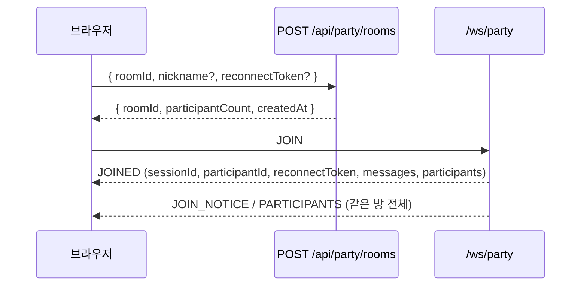

# 파티 채팅

인게임 방 ID를 공유하는 플레이어끼리 대화하는 텍스트 채팅입니다. `/party`에서 숫자 6자리 방 ID와 닉네임을 입력하면 `/party/:roomId`로 이동해 입장합니다. 방이 없으면 새로 열고, 있으면 기존 방에 들어갑니다. 방 목록·비밀번호 방은 없습니다.

## 상태와 저장

| 위치 | 내용 |
| --- | --- |
| 프로세스 메모리 | 방, 연결된 참가자, 최근 기록 (최대 300개·256 KiB) |
| PostgreSQL | 세션(`party_chat_sessions`), 참가자 프로필과 재접속 토큰 SHA-256 해시(`party_chat_participants`), 채팅·입퇴장 알림(`party_chat_messages`), 연결 로그(`party_chat_connection_events`) |

- 방 ID(6자리)는 재사용되며, 방이 열릴 때마다 고유한 세션 ID가 붙습니다.
- 재배포로 프로세스가 재시작되어도 만료 전 세션의 기록과 참가자를 DB에서 복원합니다. 끊긴 클라이언트는 몇 초 안에 같은 참가자 ID로 다시 연결되며 입·퇴장 알림이 생기지 않습니다.
- 연결 상태는 프로세스 간에 공유하지 않으므로 **앱은 단일 프로세스로 운영**합니다.
- 마지막 참가자가 나가고 3분이 지나면 세션과 DB 기록을 삭제합니다. 같은 ID로 다시 들어오면 새 세션입니다. 비정상 종료로 남은 만료 세션도 1분 주기 정리 작업이 지웁니다.

## 입장 흐름



공유 링크로 `/party/:roomId`를 직접 열면 닉네임 없이 방을 확인한 뒤 모달에서 닉네임을 받습니다(저장된 닉네임이 있으면 미리 채움).

## HTTP API

`POST /api/party/rooms`

```json
{ "roomId": "001234", "nickname": "닉네임", "reconnectToken": "optional-token" }
```

| 응답 | 조건 |
| --- | --- |
| `200` `{ roomId, participantCount, createdAt }` | 방 생성 또는 기존 방 |
| `400` | 잘못된 방 ID·닉네임, 비밀번호 필드 포함 |
| `409` | 닉네임 사용 중 (유효한 토큰으로 소유를 증명한 경우는 허용) |
| `429` | IP당 1분 12회 초과 |
| `503` | 방 200개가 찬 상태에서 새 방 생성 |

- `roomId`는 trim 후 숫자 6자리 문자열입니다. 숫자로 변환하지 않아 앞자리 0이 유지됩니다.
- 닉네임 검사는 동시 입장 경합에 대비해 WebSocket `JOIN`에서 다시 합니다.

`GET /api/party/characters`는 `{ id, name, nickname, image }[]`를 반환합니다(5분 캐시). DB의 `kind=str`, `namespace=STRCharacter`에서 `unit_key={id}0`이 이름, `{id}1`이 별명이며, 승인된 한국어 번역 → 영어 → 중국어 원문 순으로 고릅니다. 이미지는 `https://file.maynutlab.com/character/UT_Item_Hero_{id}.png`입니다.

## WebSocket 프로토콜

엔드포인트: `ws(s)://<host>/ws/party`. Origin은 `https://astral.maynutlab.com`, `ASTRAL_WS_ALLOWED_ORIGINS`, 개발 환경의 localhost만 허용합니다.

### 클라이언트 → 서버

```json
{ "type": "JOIN", "roomId": "001234", "nickname": "닉네임", "characterId": "spectator", "order": null, "reconnectToken": "optional", "diagnostics": { "attempt": 1, "lastCloseCode": 1006, "lastCloseAgoMs": 1200, "hiddenAtClose": false, "onlineAtClose": true } }
{ "type": "SET_CHARACTER", "characterId": "306" }
{ "type": "SET_ORDER", "order": "P2" }
{ "type": "CHAT", "text": "안녕하세요", "clientMessageId": "local-id" }
{ "type": "HISTORY", "before": "<가장 오래된 메시지 UUID>" }
{ "type": "PING" }
```

### 서버 → 클라이언트

| `type` | 내용 |
| --- | --- |
| `JOINED` | `sessionId`, `participantId`, `reconnectToken`, `room`, `messages`(채팅·입퇴장 알림 시간순), `participants` |
| `JOIN_NOTICE` / `LEAVE_NOTICE` | `notice: { kind, id, nickname, createdAt }`. 화면에는 `닉네임님이 채팅방에 입장했습니다.` / `…에서 나갔습니다.` |
| `CHAT` | `message: { kind: "chat", id, clientMessageId, participant: { characterId, order }, text, createdAt }` |
| `PARTICIPANTS` | 입장·퇴장·캐릭터·순서 변경 시 전체 목록 |
| `HISTORY` | `{ before, messages, hasMore }`, 50개씩 |
| `PONG` | `PING` 응답 |
| `ERROR` | `{ code, message, clientMessageId?, retryAfterMs? }` |

### 캐릭터와 순서

- 캐릭터 ID는 문자열이며 `shared/types/party.ts`의 `PARTY_CHARACTER_IDS`(`101`~`129`, `301`~`306`, 35개)와 특수 값 `spectator`(관전), `unselected`(참가했지만 미선택)를 서버가 검증합니다.
- 웹의 기본 입장은 `spectator` + 순서 `null`입니다. 관전 중에는 순서를 고를 수 없습니다.
- 관전에서 캐릭터나 `unselected`로 바꾸면 `P1`부터 시작하고, 플레이어 상태끼리 바꾸면 순서를 유지합니다. 관전으로 바꾸면 `null`이 됩니다. 순서(`P1`~`P4`)는 중복 선택할 수 있습니다.
- `JOIN.order`를 생략하면 플레이어는 `P1`로 시작합니다. 명시적 `null`이나 잘못된 값은 `INVALID_ORDER`입니다.
- 변경 내용은 DB에도 반영되어 과거 메시지에 최신 캐릭터·순서가 표시됩니다.

### 닉네임

같은 방에서 대소문자·유니코드 정규화 차이를 무시하고 중복을 거부합니다(`NICKNAME_TAKEN`). 다른 방에서는 같은 닉네임을 쓸 수 있습니다.

### 메시지 전송 보장

- `clientMessageId`(선택)가 같은 재전송은 중복 저장하지 않고 기존 메시지를 돌려줍니다. DB 부분 고유 인덱스로 재시작 후에도 유지됩니다.
- 클라이언트는 전송 즉시 입력칸을 비우고 메시지를 임시 표시합니다. DB 저장 후 받은 같은 `clientMessageId` 메시지로 교체합니다.
- 15초 안에 확인이 없거나 연결이 끊기면 미확정으로 표시하고, 재연결되면 자동 재전송합니다. 서버가 거절한 메시지에만 오류와 다시 입력 버튼을 표시합니다.
- 텍스트는 JSON 문자열로만 받고 화면에서는 텍스트로 렌더링합니다(HTML 실행 없음).
- 입장 알림은 저장을 기다리지 않고 먼저 발행하며, 저장은 방의 쓰기 큐에서 채팅과 같은 순서로 처리합니다. 저장에 실패해도 메모리 기록에는 남습니다.

## 재접속과 퇴장 유예

`JOINED.reconnectToken`은 같은 탭의 `sessionStorage`에 보관하고 서버는 SHA-256 해시만 저장합니다. 같은 세션에서 정규화된 닉네임과 유효한 토큰을 제시하면 살아 있는 참가자나 유예 중인 참가자를 같은 ID로 승계하고 이전 소켓을 정리합니다.

연결이 끊기면 참가자는 실시간 목록에서 즉시 빠지고 IP 연결 할당량도 반환되지만, 닉네임·토큰은 종료 종류에 따라 예약됩니다.

| 종료 | 판별 | 퇴장 알림 |
| --- | --- | --- |
| 명시적 퇴장 (나가기, 다른 페이지 이동) | close `1000` / `leave-room` | 즉시 |
| 창 닫기·새로고침 | close `4001` / `page-hide`, 브라우저 `1001` | 15초 뒤 (그 안에 돌아오면 없음) |
| 그 밖의 단절 (네트워크 전환, 모바일 백그라운드, 클라이언트 `4002`, heartbeat 만료) | 위 외 전부 | 서버가 감지한 시점부터 60초 뒤 |
| 서버 종료 (재배포) | SIGTERM/SIGINT 이후 종료 | 없음. 재시작 후 복원된 참가자에게 다시 60초 유예 |

유예 중 재접속은 알림을 만들지 않습니다. 유예가 끝나면 토큰을 무효화하고 퇴장 알림을 한 번 기록·발행하며 `left_at`을 채웁니다. 재시작 후에는 방을 처음 조회할 때 `left_at`이 비어 있고 토큰 해시가 있는 참가자를 유예 상태로 복원합니다.

### 클라이언트 재연결

- 대기 간격은 1초부터 두 배씩, 최대 5초입니다. 내부 복구 중에는 닉네임 모달을 띄우지 않습니다.
- 다음 경우 소켓을 `4002`로 닫고 `onclose`를 기다리지 않고 바로 재연결합니다. 응답 없는 상대에 `close()`를 부르면 브라우저가 종료 확인을 최대 60초(Chromium) 기다리기 때문입니다.
  - `heartbeat-timeout`: PING 2회 무응답 또는 55초 무수신
  - `join-timeout`: `JOINED`가 20초 안에 오지 않음
  - `liveness-timeout`: 화면 복귀·`online` 직후 PING 뒤 5초 무수신
- `pagehide`에서는 `4001`/`page-hide`로 닫고 자동 재연결을 멈춥니다. bfcache 복원(`pageshow.persisted`) 때 토큰으로 다시 연결합니다.
- `retryAfterMs`를 받으면 그 전에는 online·visibility 이벤트로도 재시도를 앞당기지 않습니다.
- 모든 `JOIN`에 직전 종료 코드·사유, 경과 시간, 종료 당시 화면 숨김·온라인 여부, 연속 시도 횟수, 첫 입장 탐색 종류를 `diagnostics`로 보냅니다.

## 제한

| 항목 | 값 |
| --- | --- |
| 방 | 최대 200개 |
| 동시 연결 | 전체 500, IP당 20 |
| 입장 시도 | IP당 1분 12회 |
| 메시지 | 연결당 1분 60회, 수신 프레임 16 KiB |
| 닉네임 / 메시지 길이 | 20자 / 1,000자 (UTF-16 코드 단위, 브라우저 `maxlength`와 동일. 일부 이모지는 2자) |
| 서버 heartbeat | 20초마다 검사·WebSocket ping, 60초 무수신 시 정리 후 60초 유예 |
| 느린 연결 | 전송 버퍼 1 MiB 초과 시 종료 |

값은 `server/utils/party-chat-limits.ts`의 `PARTY_LIMITS`와 `shared/types/party.ts`(길이·기록 상한, 클라이언트 공용)에 있습니다. `ASTRAL_WS_*` 환경변수는 공용 `/ws` 허브용이며 파티 채팅 제한에는 적용되지 않습니다.

## PiP 창

Document Picture-in-Picture를 지원하는 브라우저에서는 방 상단 버튼으로 채팅을 다른 창 위에 띄웁니다. 기존 Vue 화면을 옮기므로 연결·닉네임·작성 중인 메시지가 유지되고, 창을 닫으면 원래 페이지로 돌아옵니다. 원래 탭을 닫거나 이동하면 PiP도 닫힙니다. 지원하지 않으면 버튼을 숨기고, 요청이 거부되면 오류를 표시합니다. HTTPS 또는 localhost에서만 동작하며, 게임의 독점 전체 화면 위에 보이는지는 브라우저·OS에 따라 다릅니다.

## 배포 시 주의

- Nginx는 `/ws/party`를 HTTP/1.1 Upgrade로 프록시해야 합니다. 배포 템플릿에 포함되어 있습니다.
- IP별 제한을 프록시 뒤에서 쓰려면 `ASTRAL_TRUST_PROXY=true`로 Nginx가 덮어쓰는 `X-Real-IP`를 신뢰합니다. Docker Compose 설정은 `true`, 직접 실행 기본값은 `false`(직접 연결 주소만 사용, `X-Forwarded-For`는 무시)입니다.

## 테스트

| 명령 | 대상 |
| --- | --- |
| `pnpm test:party:rooms` | 방 생명주기, TTL, 쓰기 순서 |
| `pnpm test:party:route` | WebSocket·HTTP 핸들러 |
| `pnpm test:party:client` | 재연결 클라이언트 |
| `pnpm test:party:adapter` | WebSocket 어댑터 |
| `pnpm test:party [url]` | 실행 중인 서버 대상 HTTP·WebSocket 통합 |
| `pnpm test:party:storage [url]` | 실행 중인 서버 대상 DB 저장·과거 기록 |

마지막 두 개는 연결된 DB에 실제 방과 메시지를 만듭니다(3분 뒤 정리).

## 연결 로그

끊김 분석용으로 `party_chat_connection_events`에 연결 이벤트를 남깁니다. 방이 삭제되어도 남고 30일 뒤 정리됩니다. IP는 저장하지 않으며, 채팅과 분리된 비동기 쓰기라 실패해도 채팅에 영향이 없습니다.

| `event` | 시점 | 주요 값 |
| --- | --- | --- |
| `connect` | 소켓 연결 | `connection_id`, `detail.userAgent` |
| `join` | 입장·재입장 | `detail.resumed`, `detail.restored`, `detail.disconnectedMs`, `detail.diagnostics` |
| `join_rejected` | 입장 거절 | `detail.code` |
| `disconnect` | 소켓 종료 | `close_code`, `close_reason`, `departure`(`leave`, `page-hide`, `loss`, `replaced`, `shutdown`, `not-joined`), `connected_ms`, `detail.serverReason` |
| `leave_notice` | 퇴장 알림 | `departure`(`leave`, `page-hide`, `loss`, `restored`) |
| `room_restored` | 재시작 후 방 복원 | `detail.participants` |
| `server_shutdown` | 서버 종료 | |

```sql
-- 최근 24시간 종료 원인
SELECT departure, close_code, detail->>'serverReason' AS server_reason, count(*)
FROM party_chat_connection_events
WHERE event = 'disconnect' AND created_at > now() - interval '24 hours'
GROUP BY 1, 2, 3 ORDER BY count(*) DESC;

-- 특정 방의 연결 이력
SELECT created_at, event, nickname, departure, close_code, close_reason, connected_ms, detail
FROM party_chat_connection_events
WHERE room_id = '001234' AND created_at > now() - interval '2 hours'
ORDER BY id;

-- 재연결 시 보고된 직전 종료 정보
SELECT created_at, room_id, nickname, detail->'diagnostics' AS diagnostics
FROM party_chat_connection_events
WHERE event = 'join' AND (detail->>'resumed')::boolean
ORDER BY id DESC LIMIT 100;

-- 유예 안에 돌아오지 못한 퇴장
SELECT departure, count(*) FROM party_chat_connection_events
WHERE event = 'leave_notice' AND created_at > now() - interval '7 days'
GROUP BY 1;
```
