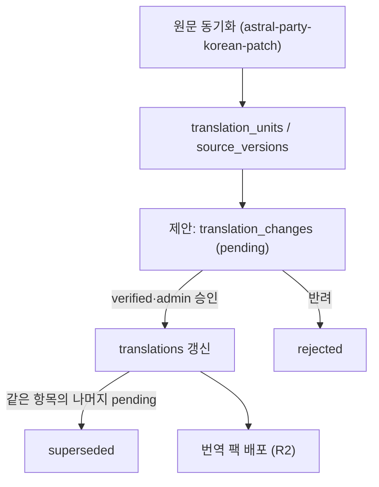

# 번역

## 데이터 흐름

- 승인된 최종 번역은 `translations`, 모든 제안과 검토 이력은 `translation_changes`에 있습니다. 상태는 `pending`, `approved`, `rejected`, `superseded`입니다.
- 한 항목에 pending 제안이 여러 개 있을 수 있습니다. 하나를 승인하면 같은 항목·locale의 나머지 pending은 `superseded`가 됩니다.
- 원문이 바뀌어도 마지막 승인 번역은 유지됩니다. 승인 당시 원문과 현재 원문이 다르면 화면에 `확인 필요`로 표시합니다.
- 제안 종류(`change_kind`):
  - `translation_edit`: 번역 문구 변경
  - `retain_confirmation`: `유지` 버튼. 기존 번역을 현재 원문 버전에도 그대로 쓰겠다는 확인 요청
- 승인·반려는 `verified`, `admin`만 할 수 있습니다.

## 화면

| 경로 | 내용 |
| --- | --- |
| `/translate` | 카테고리별 진행도, 최근 번역 |
| `/translate/editor` | 목록·검색·필터, 번역 입력, 임시저장, 일괄 저장, 유지, AI 번역, 이력, 댓글, 용어집 |
| `/translate/review` | pending 제안 검토, 단건·일괄 승인·반려 |
| `/translate/glossary` | 공통 용어·캐릭터 문체 조회, 다국어 검색, 제안·검토·보관 |
| `/change` | 원문 변경·번역 변경 기록 |

에디터(목록·댓글)와 변경 기록 화면은 `/ws` 토픽(`editor`, `editor:comment`, `change:translation`)으로 다른 사용자의 변경을 실시간 반영합니다. 검토 화면은 요청 시점 데이터를 사용합니다.

## 에디터 구조

`app/pages/translate/editor.vue`는 화면 조합만 하고 상태는 composable에 있습니다. 하위 컴포넌트는 `app/utils/editor-page-state.ts`의 `EditorPageState`로 같은 상태를 공유합니다.

| composable | 책임 |
| --- | --- |
| `editor-items` | 목록과 진행도 조회 |
| `editor-query` | 검색·필터·페이지를 URL 쿼리와 동기화 |
| `editor-actions` | 저장, 유지, 되돌리기, 검토 |
| `editor-drafts` | 미저장 번역의 브라우저 저장 (키: translation unit UUID) |
| `editor-realtime` | 실시간 이벤트 반영 |
| `editor-preferences` | 표시 언어, diff 방식 |
| `editor-dictionaries`, `editor-dictionary-panel` | 용어집 조회·추가, 사전 패널 |
| `editor-layout`, `editor-visual-viewport` | 사이드바, 모바일 키보드 대응 |

임시저장은 여러 탭에서 공유됩니다. 한 탭이 빈 저장소를 읽어도 다른 탭의 임시저장을 지우지 않습니다.

## 저장과 제한

- 번역 저장은 단건도 `PATCH /api/editor/items/batch`를 사용합니다.
- 사용자별로 저장·검토·AI 번역에 분·시간 단위 요청 제한이 있습니다(`server/utils/editor-rate-limit.ts`).
- AI 번역(`POST /api/editor/items/:id/ai-translation`)은 서버가 `AI_BASE_URL`의 OpenAI 호환 게이트웨이를 호출해 제안 문구를 돌려줍니다. 자동 저장하지 않으며, 사용자가 확인 후 저장합니다.

## 용어집

- 로그인 사용자는 용어집을 만들 수 있고 공개(`public`)·비공개(`private`)를 고릅니다. 기본은 비공개입니다.
- 공개 용어집은 모든 사용자, 비공개 용어집은 소유자와 관리자만 봅니다.
- 항목 추가는 소유자와 관리자만 할 수 있습니다(`canEdit`).
- 제공 API: 용어집 목록·생성, 항목 목록(검색, 50개씩)·추가. 용어집·항목의 수정·삭제 API는 화면에서 쓰지 않아 제공하지 않습니다.

### 공통 번역 기준

기존 개인·공개 용어집은 그대로 유지합니다. `verified`·`admin`은 별도의 공개 공통 용어집(`is_team`)을 만들 수 있습니다. 공개 용어집이라는 이유만으로 공통 기준으로 승격하지 않습니다.

- 용어는 한국어와 일본어·중국어 중 한 언어만으로 제안할 수 있습니다. 간체·번체는 구분하며 자동 변환하지 않습니다.
- 공통 항목은 직접 추가·수정하지 않고 `editor_dictionary_proposals`로 제안합니다. 로그인 사용자가 제안하고 검수 담당자가 확정·보류·반려합니다. 작성자는 본인의 미처리 제안을 철회할 수 있습니다.
- 상태는 `pending`, `held`, `approved`, `rejected`, `withdrawn`입니다. 보류는 재개 후 다시 승인할 수 있으며 처리 사유와 이력을 보존합니다. `requestId`가 같은 제출은 동일한 제안으로 처리합니다.
- 기존 기준 변경 시 비교 리비전을 보존합니다. 승인 트랜잭션이 제안·항목을 잠그고 리비전을 검사하므로 경쟁 변경안 중 하나만 확정됩니다. 언어 간 의미 차이가 미해결이면 승인을 거부합니다.
- 용어 metadata에는 언어별 표기, 허용·과거·비권장 표현, 적용 범위, 대조 메모·근거 Key가 있습니다. 문체에는 호칭·어미·관계 예외·대표 대사를 기록합니다.
- 보관도 변경 제안·검토로 처리합니다. 보관 항목은 기본 목록과 자동 안내에서 제외하고 보관 필터·이력에서는 볼 수 있습니다.
- 에디터 `사전 → 공통 기준`은 현재 항목의 중국어·일본어 원문에 관련된 확정 용어를 보여줍니다. 조회 실패는 번역 입력을 막지 않습니다. 캐릭터 문체는 수동 참고용이며 화자 지정으로 저장하지 않습니다.
- 파일 이름으로 화자를 추정하지 않습니다. 캐릭터 범위 규칙은 자동 적용하지 않고 수동으로 문맥을 확인합니다. 태그·변수 안의 표현은 원문 매칭에서 제외합니다.
- 사용처는 기존 번역 검색과 Key 이동 경로를 사용합니다. 다른 항목은 새 탭에서 열어 미제출 번역을 보존합니다. 검색 결과는 수정 의무나 오류 수가 아닙니다.
- 공통 기준 승인·보관은 `translations`, 번역 승인 상태, 배포 팩을 수정하지 않습니다. 저장 시 경고·AI 규칙 주입·일괄 치환은 이번 범위에 포함하지 않습니다.

선택한 번역 항목은 사전 패널을 열지 않아도 원문의 일치 표현에 점선 밑줄을 표시합니다. 클릭하거나 키보드로 열면 권장 표기·결정 이유·범위와 복사·사용처·상세 링크를 제공합니다. 원문 조회는 공통 기준 패널과 공유하며, 항목 또는 원문 버전이 바뀌면 갱신하고 이전 응답은 버립니다. 언어별 등록 표현만 대조하고 같은 위치에서 시작하는 표현은 긴 용어를 우선합니다. 같은 표현의 기준은 모두 표시합니다. 태그·변수·기존 Astral 링크를 유지하고, 유니코드 정규화로 매칭하더라도 표시 원문과 번역 입력은 변경하지 않습니다.

읽기 API는 항목별 공통 기준(`/api/editor/glossary/related`)과 용어 단건 조회를 추가했습니다. 제안 목록·제출·처리는 `/api/editor/dictionaries/:id/proposals` 하위에서 수행하며, 같은 원본 검증과 최신 세션 역할 검사를 사용합니다.

`pnpm test:glossary`는 순수 매칭·검증 테스트와 실제 PostgreSQL 테스트를 실행합니다. DB 테스트는 명시적인 `TEST_DATABASE_URL`만 사용하고 임의 schema를 생성·삭제하며, 지정하지 않으면 DB 사례는 skip으로 표시합니다. 운영 DB를 사용하지 마세요.

사용처에는 원문 문맥과 현재 번역 상태를 함께 표시합니다. 보류·반려 사유는 창을 연 제안에 고정하며, 페이지·검토 상태는 URL에 유지합니다. 같은 원문의 재조회 중에는 열린 카드를 유지하고, 원문 변경·조회 실패 시에는 이전 기준을 지웁니다.

### 실제 번역 데이터와 기초 용어집

운영 배포는 기존 DB를 그대로 사용하며 `0020_base_glossary.sql`이 기초 용어를 자동 등록합니다. 로컬 전용 명령을 운영에서 실행할 필요가 없습니다. 승인·배포·검증·복구 절차는 [공통 용어집 운영 반영](glossary-release.md)을 따릅니다.

로컬 개발 환경은 운영 사이트의 공개 읽기 API에서 원문과 기존 승인 번역을 가져올 수 있습니다. 운영 DB 연결 정보는 사용하지 않습니다.

1. 기존 migration으로 준비한 별도의 로컬 DB를 `ASTRAL_MIRROR_DATABASE_URL`에 지정합니다.
2. `pnpm data:sync`로 공개 원문·승인 번역을 동기화합니다. `pnpm data:sync --watch`는 15분마다 갱신하며 실패하면 기존 사본을 유지합니다.
3. 데이터가 migration 이후에 채워진 로컬 사본은 `pnpm glossary:seed`로 같은 검증·등록 SQL을 실행할 수 있습니다. 기존 기준은 덮어쓰지 않습니다.
4. 앱의 `DATABASE_URL`을 같은 로컬 DB로 지정합니다. 화면을 다시 조회하면 최신 사본을 사용합니다.

기초 용어는 2026-10-31 공개 승인 번역에서 가져온 캐릭터·재화·상태 효과·카드·맵·전투 용어 85개입니다. 각 항목의 일본어·중국어·한국어와 실제 Key를 보존하며 문체나 중국어 의미 합의를 추정하지 않습니다. 중국어 대조 상태는 미기록으로 시작합니다.

동기화는 공개 API가 제공하는 원문 UUID를 유지합니다. 현재 원문에 승인된 번역만 로컬 승인 사본으로 저장하며, 미번역·대기·원문 재확인 전인 문구를 승인 처리하지 않습니다. 기존 로컬 사용자가 승인한 번역과 용어집은 덮어쓰거나 삭제하지 않습니다. 동기화 이력은 Bot의 `공개 번역 동기화` 그룹으로 구분하고 원래 운영 작성자·검토 이력으로 표시하지 않습니다. 실제 원문 최초 발견 이력은 공개 API에 없으므로 `PUBLIC_SNAPSHOT` 관측 리비전으로 보관합니다.

공통 용어집에는 단건 제안·수정·보관과 기존 검토만 제공합니다. 일괄 추가·삭제·AI 추출·JSON 가져오기 화면과 API는 제공하지 않습니다.

## 번역 팩

관리자 페이지의 `번역 팩 배포`는 `translations`의 `ko` 번역 전체를 플러그인용 팩으로 만들어 Cloudflare R2에 올립니다.

| 객체 키 | 내용 | Cache-Control |
| --- | --- | --- |
| `translation-pack/latest.json` | 최신 팩 포인터 (`number`, `version`, `revision`, `publishedAt`, `path`, `size`, `sha256`) | `no-cache` |
| `translation-pack/packs/{number}.json.gz` | gzip 팩 | `public, max-age=31536000, immutable` |

- 팩 번호는 `translation_pack_number_seq`에서 받아 재사용하지 않습니다. 플러그인(`astral-party-korean-plugin`)은 `latest.json`의 번호만 비교합니다.
- 배포 기록은 `translation_pack_publications`에 남습니다.
- 성공한 배포는 아직 팩에 연결되지 않은 승인된 `ko` 번역 변경 이력을 `translation_changes.pack_number`로 연결합니다. 같은 항목의 중간 승인 이력과 유지 확인도 모두 연결하며, 이전 배포 연결은 바꾸지 않습니다. 대기·반려·자동 종료 제안과 원문 변경 이력은 대상이 아닙니다.
- 최초 도입 시 기존 승인 이력은 미연결로 남고, migration 적용 후 첫 성공 배포에 모두 연결됩니다. 과거 팩으로 소급 배정하지 않습니다.
- 팩 내용·게임 버전/리비전·변경 이력 연결은 같은 repeatable-read 스냅샷을 사용합니다. 스냅샷 이후 승인된 변경은 다음 팩으로 넘어가며, 업로드 실패 시 배포 기록과 이력 연결은 함께 롤백됩니다.
- 변경 기록과 에디터의 항목별 번역 이력에는 `배포 #번호 · 게임 버전 · 리비전`을 표시하고, 미연결 승인 이력은 `미배포`로 표시합니다. 발행 커밋 후 WebSocket 알림으로 열린 화면을 갱신합니다. 이는 배포 단위의 변경 이력 묶음이며, 중간 문구가 팩에 그대로 남아 있다는 뜻은 아닙니다.
- 응답 후 백그라운드에서 최근 10개와 게임 버전·리비전별 마지막 팩을 제외한 오래된 팩을 삭제합니다. 실패한 삭제는 다음 배포 때 재시도합니다.
- Cloudflare는 `.json`을 기본 캐시하지 않고 `.gz`는 캐시하므로 별도 Cache Rule이나 퍼지가 필요 없습니다.
- 필요한 환경변수와 R2 권한은 [deployment.md](deployment.md#번역-팩-r2)를 참고하세요.
